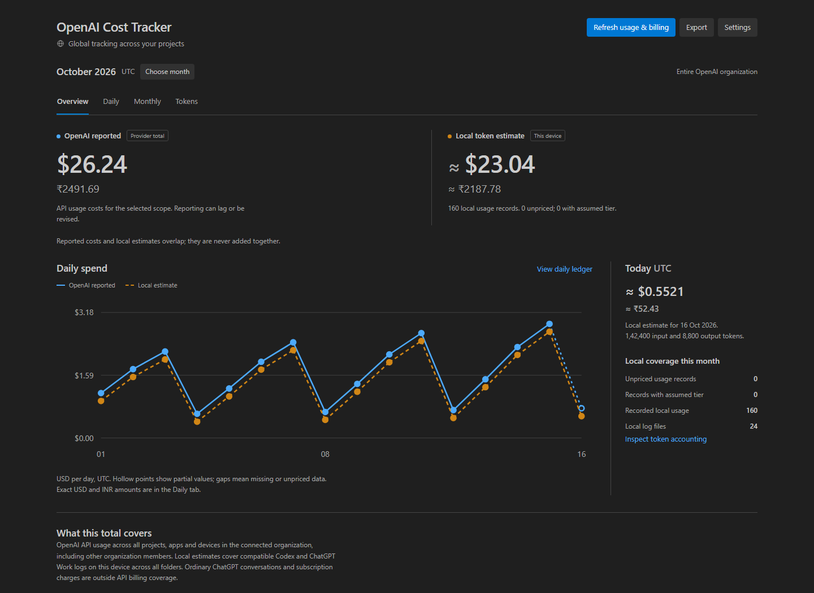

# OpenAI Cost Tracker — USD & INR

A lightweight, global VS Code extension for OpenAI API spending. It shows daily costs and monthly usage across projects, with organization-reported costs across apps and devices alongside a separate estimate from your local Codex logs. USD and Indian rupees appear in the status bar and dashboard.

The interface follows VS Code's light, dark and high-contrast themes. **Overview**, **Daily**, **Monthly** and **Tokens** tabs keep spend trends, full ledgers and individual token costs separate. Open it from the status bar, the **AI Costs** Activity Bar shortcut, or the Command Palette.



*Example data, not a real account statement. [Light-theme example](docs/images/overview-light.png).*

**For the most accurate spend total, connect OpenAI billing.** Local token counts alone cannot establish your actual bill. The extension keeps reported costs and local estimates separate because they overlap; it never adds them together.

## What is covered

| Source | Coverage |
| --- | --- |
| OpenAI API billing | Selected UTC month's costs reported by the organization Costs API, including its available daily, project and line-item breakdown. Current-month values are month to date. Reporting can lag or be revised. |
| Codex in VS Code | Token estimates from compatible local Codex session logs. |
| Codex desktop | Token estimates from the same local Codex log directory, including supported subagent records. |
| ChatGPT desktop | Compatible local Work/Codex session logs only. Ordinary ChatGPT conversations and ChatGPT subscription charges are not captured. |

App labels come from the session's recorded origin. A resumed chat retains that origin, so this is not guaranteed attribution to whichever window was used most recently. Shared logs and replayed records are deduplicated. The Costs API does not itself identify desktop apps or editor windows.

## Global operation

The open folder does not filter usage. The collector reads the configured local Codex data directory across all projects; organization billing includes API costs from any app or device billed to that organization. Application settings are read at user level, and project/workspace overrides are ignored. The extension runs on the local desktop host even when the editor is connected to SSH, WSL or a container.

Each VS Code window gets the status bar and Activity Bar view. Windows coordinate shared index writes and billing/FX requests, so they do not add their totals together or duplicate the same network refresh. Changing or disconnecting billing invalidates in-flight results across windows. Different windows may inspect different months.

Production activation uses VS Code's **Apply Extension to All Profiles** operation once when needed, with a shared lock and verification against the installation inventory. If a future VS Code version changes that operation, select it manually from this extension's gear menu. The internal extension ID remains `abishek-local.ai-cost-ledger` so existing installations and stored credentials can be upgraded.

## Install and connect

Requires desktop VS Code 1.96 or later. Works in empty, trusted, restricted and virtual desktop windows, regardless of the project. VS Code for the Web cannot run the local Node.js collector.

1. In VS Code, run **Extensions: Install from VSIX…** from the Command Palette and select `openai-cost-tracker-0.2.0.vsix` from this folder. Reload VS Code if prompted.
2. Run **OpenAI Cost Tracker: Open Dashboard**, click the AI amount in the status bar, or open **AI Costs** in the Activity Bar. Local indexing begins automatically.
3. Run **OpenAI Cost Tracker: Connect OpenAI Billing (Admin Key)** and enter an OpenAI organization Admin key with access to the Costs API into the password input. A normal inference API key usually does not have organization billing access.
4. If needed, set **OpenAI Cost Tracker: Billing Project Ids** in VS Code's user settings to your API project IDs. The default includes the **entire organization**, which can include other people, applications and devices. An optional organization ID can select the intended organization.

Enter the key only into the extension's password prompt, never into chat, source files or settings JSON. It is stored with VS Code `SecretStorage` and sent only to `api.openai.com` for billing requests. **Disconnect OpenAI Billing** removes that stored key and cached billing snapshots; it does not revoke the key at OpenAI.

The extension reads `CODEX_HOME`, falling back to `~/.codex`. Set `aiCostLedger.codexHome` if your desktop apps use another local directory.

### Private storage

Set `aiCostLedger.dataDirectory` in user settings to an absolute folder for the shared private cache. Empty uses `~/.ai-cost-ledger`. Run `node scripts/configure-storage.js` after development setup to use this repository's **local-data** folder; it preserves JSON comments, saves a private settings backup there, and migrates a compatible legacy index if present. Reload all VS Code windows after changing the location.

`local-data/` is ignored by Git. It can contain private usage metadata and a settings backup; do not force-add it. API credentials remain in VS Code SecretStorage, never in this directory. Source code, development tools and the cache can live together on another drive, while VS Code maintains its installed extension and credential storage in its own managed locations.

## Reading the numbers

- **OpenAI reported** is the Costs API's USD total for the selected UTC month and billing scope; the current month is month to date. It is not an invoice, credit balance, card debit or final tax calculation. The dashboard shows the last successful sync; failed refreshes retain an available previous snapshot for that scope and month with a warning.
- **Local token estimate** prices the usable token records found on this computer. Unpriced records remain visible as coverage gaps instead of being treated as free. If any records are unpriced, the displayed estimate is a partial subtotal.
- **INR** is USD multiplied by the displayed dated reference rate. Frankfurter supplies the reference rate; you can set `aiCostLedger.usdInr` to a positive manual rate. Currency conversion does not include bank spreads, card fees or taxes, and does not recreate historical settlement rates. A setting of `0` restores reference-rate mode.
- **Dates use UTC**, including “today,” the monthly total and billing buckets. This may differ from the local calendar date in India.

The status bar labels the selected month as `YYYY-MM` and prefers its provider-reported costs once available. Otherwise it shows the local estimate with an `≈` marker. Click it to inspect coverage and assumptions.

### Daily costs and monthly history

Use the dashboard's **Choose Month** control or run **OpenAI Cost Tracker: Choose Month** to inspect the current month or a past month. Monthly totals, app/model breakdowns, token-type costs and billing line items follow the selected month. The **Today** card always refers to the actual current UTC day, even while you inspect a historical month.

The **Daily ledger** lists dates in the selected UTC month, recorded input/output token counts, local estimated cost in USD/INR and provider-reported cost in USD/INR. Local and reported columns remain separate: a local usage record is evidence for a token estimate, while a reported daily amount covers the selected billing scope and may include other activity.

The **Monthly history** shows recorded local usage and estimated totals across indexed months, alongside provider totals for months already fetched in the current billing scope. Selecting a month fetches its reported costs on demand when billing is connected. Successful results are cached by organization/project scope and month; a historical month that has not been fetched is labeled **Not fetched**, not zero. Selecting a different billing scope does not reuse totals from another scope.

Historical token counts can be available even when local costs are unpriced. Bundled rates cover only 16 October–15 November 2026, so older local estimates need verified historical rate overrides. The Costs API can still supply provider-reported historical costs independently of these rate cards, subject to the data available to your organization. A missing billing connection, failed request or unavailable snapshot is not proof of zero spending.

## Accuracy rules

Local estimates use exact recorded token counts, separate uncached input, cache reads, cache writes and output, and apply the context threshold per request. Reasoning tokens are already included in output and are not charged a second time. Fixed-point integer arithmetic retains sub-cent amounts; display rounding does not change the accounting export.

The **Cost by token type** table shows the count and USD/INR cost of each billable token category individually. Reasoning and other output counts and costs appear beneath it as a split of output, without adding a second charge. Missing reasoning detail stays unknown; it does not prevent pricing the full output count. The **OpenAI billing line items** table preserves provider-reported costs and any quantity/unit supplied by OpenAI. To compare with the OpenAI dashboard, select the same organization, projects and UTC month and allow for reporting delays; local estimates are never used to overwrite reported charges.

Unknown models, unavailable dated rates, missing cache-write counts, inconsistent counters, counter resets and gaps in request allocation can leave records unpriced. Missing processing tiers use the explicit `aiCostLedger.assumedTier` setting, which defaults to `standard`; the dashboard counts these assumptions. Set it to `unknown` to avoid pricing requests with a missing tier.

Local estimates exclude hosted-tool fees, image/audio generation charges, regional surcharges and negotiated discounts. Provider-reported billing remains the appropriate total for charges reported within your selected scope, regardless of local log coverage.

Bundled price cards were verified on **16 October 2026** and are valid for usage dated **2026-10-16 inclusive through 2026-11-16 exclusive**. Earlier history stays unpriced unless you supply verified historical rates. After the validity window, new local usage also stays unpriced until matching rates are supplied or the extension is updated. Billing retrieval does not depend on the bundled price cards.

### Custom or historical rates

Add versioned cards to `aiCostLedger.rateOverrides` in user settings. This example describes the schema only: **replace the placeholder model, dates and illustrative prices with verified rates before using it**.

```json
{
  "aiCostLedger.rateOverrides": [
    {
      "model": "your-exact-model-id",
      "tier": "standard",
      "from": "2026-10-01",
      "to": "2026-10-16",
      "threshold": 272000,
      "short": ["1.00", "0.10", "1.25", "5.00"],
      "long": ["2.00", "0.20", "2.50", "7.50"],
      "verified": "2026-10-16",
      "source": "Your verified pricing source"
    }
  ]
}
```

Both arrays contain **USD per million tokens**, in this order: **uncached input, cached input, cache-write input, output**. Values must be non-negative, with at most six decimal places. `short` applies when total input tokens are at or below `threshold`; `long` applies above it. `from` is inclusive and `to` is exclusive, using UTC dates. The model ID and processing tier must match the record; `default` normalizes to `standard` and `priority` to `fast`.

A valid matching override takes precedence over a bundled card. Overlapping matching overrides leave the record unpriced. Invalid cards are ignored and counted in the dashboard. A price override cannot repair missing token evidence.

## Commands and settings

All commands are available in the Command Palette under **OpenAI Cost Tracker**:

| Command | Action |
| --- | --- |
| Open Dashboard | Show daily costs, monthly history, reported costs, local totals and coverage. |
| Choose Month | Select the current or a past UTC month; fetch that month's reported costs when connected. |
| Refresh Usage and Billing | Scan retained logs and refresh the selected month's reported costs. |
| Connect OpenAI Billing (Admin Key) | Store or replace the billing credential and request costs. |
| Disconnect OpenAI Billing | Remove the credential and cached reported billing. |
| Export Accounting JSON | Save local usage records, estimates, available reported costs, FX and assumptions. |
| Update USD to INR Reference Rate | Refresh the reference rate; a configured manual rate still takes precedence. |

Search Settings for `@ext:abishek-local.ai-cost-ledger` to find all options. Billing refreshes every 15 minutes by default; `aiCostLedger.billingRefreshMinutes` accepts 5–1440 minutes. Reference FX refreshes approximately daily. Log changes trigger a debounced scan, with a one-minute polling fallback.

## Performance, privacy and limits

The extension uses built-in Node.js modules and **no runtime dependencies**. Incremental log indexing runs in a worker thread, with file offsets and a local checkpoint so unchanged file contents do not need rereading. Initial indexing can take longer for large histories; the dashboard exposes scan time and bytes read.

Prompts, responses and tool output are not retained in the index or uploaded. The local index and exports contain accounting metadata such as session IDs, model IDs, token counts, timestamps and recorded origin. The index also retains local log paths. There is **no telemetry**. Network requests are limited to OpenAI billing when connected and the Frankfurter currency-pair lookup. Reference FX works without a billing credential.

The extension runs while VS Code is open. It catches up from retained logs when reopened; it does not install a background service or intercept traffic. It runs on the local UI host, including when VS Code connects to a remote workspace. Remote machines, cloud-only sessions and other Codex directories are not automatically collected.

Indexed counters are retained when source logs are archived or deleted, preventing those previously indexed records from vanishing from the ledger. Records deleted before indexing cannot be recovered. Unrecognized or malformed logs are flagged when detected, but the extension cannot prove that all activity produced a local record.

## Build from source

On Windows, prepare a project-local toolchain:

```powershell
.\scripts\setup.ps1
.\scripts\dev.ps1 test
.\scripts\dev.ps1 verify:ui
.\scripts\dev.ps1 package
```

Setup downloads pinned portable Node.js, checks its published SHA-256, installs locked development packages under `node_modules/`, and places the test browser and npm cache under `.tools/`. All are ignored by Git. It does not replace system Node or install global npm packages. The extension itself has **zero runtime dependencies**; Playwright and jsonc-parser are development tools only and are excluded from the VSIX.

With Node.js 24 already available on another OS, use `npm ci --ignore-scripts`, `npm test`, and `npm run package`. UI verification also needs `PLAYWRIGHT_BROWSERS_PATH` set to this project's `.tools/browsers` while running `npx playwright install chromium --only-shell`. The CI workflow runs accounting and browser checks on each push and pull request.

The package script creates `openai-cost-tracker-0.2.0.vsix`. Installing it does not connect billing automatically. For real Windows VS Code integration checks, run `scripts/test-host.ps1 empty` and `scripts/test-host.ps1 restricted`; these use isolated profiles and synthetic logs from three projects.

## Design references

The dashboard was redesigned using [Anthropic frontend-design](https://skills.sh/anthropics/skills/frontend-design) and [Vercel web-design-guidelines](https://skills.sh/vercel-labs/agent-skills/web-design-guidelines), selected from the Skills Leaderboard. It uses native VS Code typography and colors, semantic tables, keyboard-accessible tabs, and no external fonts or UI framework.

## Sources

- [OpenAI API pricing](https://developers.openai.com/api/docs/pricing)
- [OpenAI organization Costs API](https://developers.openai.com/api/reference/resources/admin/subresources/organization/subresources/usage/methods/costs)
- [Frankfurter reference exchange rates](https://frankfurter.dev/)

MPL-2.0 licensed, preserving the repository’s original license. This is a personal extension and is not an official OpenAI product.
